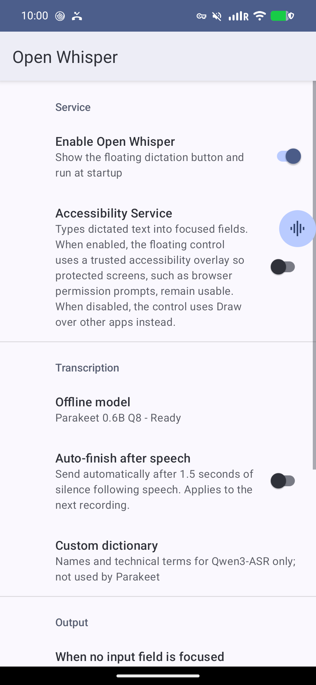
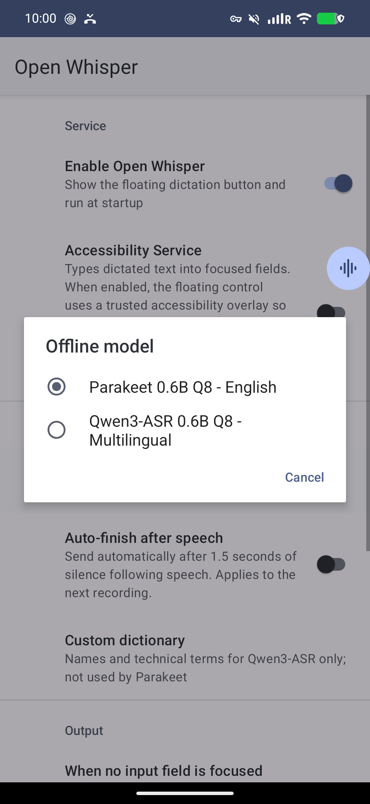

# Speech To Text

https://github.com/user-attachments/assets/49acff04-5619-49ba-93c3-5d43468ca49a

On-device dictation demonstrated in a local chat.

<p>
  
  
</p>

Android floating dictation app. Transcribes on device using Parakeet or Qwen3-ASR via transcribe.cpp; audio stays on the device. Recordings are limited to 5 minutes.

- Requirements: Android 8.0+ and an ARM64 CPU with FP16 SIMD and dot-product support.
- Setup: open the app, grant microphone and overlay permissions, choose Parakeet (English, 731 MB) or Qwen3-ASR (multilingual, 850 MB), then download it. Internet is needed for the download; transcription works offline afterward.
- Custom dictionary: in Settings, enter one word or phrase per line, most important first. Qwen3-ASR uses these as hints; Parakeet ignores them. Blank lines and duplicates are ignored. Clear the list to disable it. Long lists may be shortened to fit the model's context.
- Use: focus a text field, tap the floating button to record, then tap Send to transcribe. Enable Accessibility Service from the app's main screen to insert text. Without a focused field or accessibility, choose the fallback destination in Settings. Tap X to cancel; drag the control to move it.
- Voice detection: on-device Silero VAD 6.2 removes sustained silence before transcription while retaining short pauses and about 480 ms around speech boundaries. Enable "Auto-finish after speech" to also send after 1.5 seconds of silence following speech. Auto-finish is off by default; Send and X still work manually.
- Build: install JDK 21 and the Android SDK (platform/build-tools 34, NDK 28.2.13676358, CMake 3.31.6), set `ANDROID_HOME` to the SDK directory, then run `./gradlew assembleDebug` from the project directory (`gradlew.bat assembleDebug` on Windows). The first build downloads dependencies, including transcribe.cpp; Git must be installed. APK: `app/build/outputs/apk/debug/app-debug.apk`.
- Install from the project directory with `adb install -r app/build/outputs/apk/debug/app-debug.apk`, then open the app and complete setup.
- When no input field is focused: choose "Copy to clipboard" (default) or "Run Termux command" in Settings. Also applies when accessibility is unavailable. Changes take effect immediately.
- Optional Termux action: set "Termux script path" in Settings to an absolute path or `~/` path, e.g. `~/bin/handle_transcription.sh`. Requires Termux, your script, and permission to run Termux commands. The script runs with Bash from the Termux home directory and receives the transcription as its first argument. No path is configured by default; an unset or incorrectly formatted path shows an error. Existing users must set their script path after updating.

## Capture the demo

Reproduce with AndroidX UI Automator on an unlocked, authorized phone with the debug app, a downloaded model, and Accessibility Service enabled. Turn off Auto-finish after speech. Requires the build tools above, Python 3, and `adb`.

From the myscripts directory:

```bash
CWD="$PWD/repos/SpeechToText" run_script r/android/gradle.sh assembleDebug assembleDebugAndroidTest
run_script repos/SpeechToText/scripts/capture_demo.py --serial DEVICE --video
```

`--video` requires FFmpeg and saves `docs/screenshots/demo.mp4` with the bundled voice track. Recording starts in the chat and ends after the message is sent. Upload the MP4 through GitHub's README editor and put its attachment URL on its own line for inline playback.

The demo plays a bundled voice clip into the microphone, checks the transcription, and sends it in the local chat. Use a quiet room; media volume is restored afterward. Output: `docs/screenshots/`. The launcher reinstalls the debug APKs without clearing app data and reconnects the already-enabled accessibility service after testing.

Only the two settings screenshots are saved. Use `--demo` to also check the message flow without video, or omit both flags for settings only. Use `--current NAME` for an extra screen without running tests, or `--output DIR` for another destination. Extend `app/src/androidTest/java/com/ross/speechtotext/DemoCaptureTest.java` for new flows. Outside myscripts, build with `./gradlew assembleDebug assembleDebugAndroidTest`, then use `python3 scripts/capture_demo.py --serial DEVICE --video`.

## Releases

Push a tag such as `v1.0.1` to build a signed ARM64 APK and publish it with SHA-256 checksums on GitHub Releases. Tags must be `vMAJOR.MINOR.PATCH` with components 0-999; versionCode is `MAJOR * 1000000 + MINOR * 1000 + PATCH` and must increase for updates.

GitHub Actions requires repository secrets `RELEASE_KEYSTORE_BASE64`, `RELEASE_STORE_PASSWORD`, `RELEASE_KEY_ALIAS`, and `RELEASE_KEY_PASSWORD`. Keep a private backup of the keystore and passwords: future updates must use the same key.

For local releases, set `RELEASE_STORE_FILE` (absolute keystore path), `RELEASE_STORE_PASSWORD`, `RELEASE_KEY_ALIAS`, `RELEASE_KEY_PASSWORD`, `RELEASE_VERSION_CODE`, and `RELEASE_VERSION_NAME`, then run `./gradlew assembleRelease` (`gradlew.bat assembleRelease` on Windows) from the project directory. Output: `app/build/outputs/apk/release/app-release.apk`. Missing signing credentials fail the build.

Release APKs use a dedicated signing key. Uninstall an existing debug build before the first release install (this removes its app data). Later release APKs install as updates.
